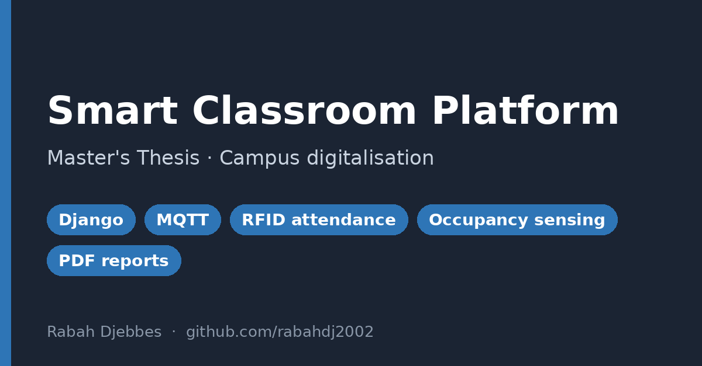
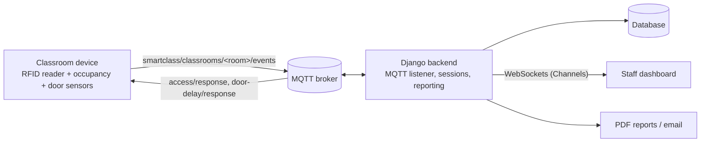

# Smart Classroom Platform



**An IoT platform that digitalises campus classrooms.**
Classroom devices report occupancy, door status and RFID badge scans over MQTT. A Django control centre turns those events into live room status, teaching sessions, attendance records and PDF reports, so staff no longer track rooms and attendance by hand.

> Master's thesis – Automatic Control and Industrial Computing, University of Constantine 1 (2026).

---

## Core Features

- **Live classroom status** via MQTT (occupancy and door sensors), pushed to the browser over WebSockets (Django Channels)
- **RFID access and attendance**: teacher access requests are approved or denied by timetable window; teacher and student badges are recorded automatically
- **Session lifecycle**: start, split, close and auto-finish sessions on schedule
- **PDF attendance reports** with session summary and student roster, with optional SMTP email delivery
- **Academic records**: classrooms, timetables, students, specializations and staff
- **Export / restore** of classes, sessions and students for backup
- **Admin controls**: pagination, UI density, KPI badges and bulk actions
- **In-app MQTT integration guide** for device developers

## Architecture



## Tech Stack

- Python 3.10+
- Django 5.1
- SQLite (default)
- MQTT (paho-mqtt)
- ReportLab (PDF generation)
- Django Channels + Daphne (WebSockets)
- Docker, Gunicorn

## Repository Layout

- backend/ - Django project
- backend/dashboard/ - main application (views, models, MQTT, reporting)
- backend/smartclass/ - Django project settings and URLs
- backend/static/ - dashboard static assets
- template/ - original UI template assets (reference)

## Quick Start

### 1) Create and activate virtual environment

Windows PowerShell:

```powershell
python -m venv .venv
.\.venv\Scripts\Activate.ps1
```

### 2) Install dependencies

```powershell
pip install -r backend/requirements.txt
```

### 3) Apply migrations

```powershell
python backend/manage.py migrate
```

### 4) Create admin user (if needed)

```powershell
python backend/manage.py createsuperuser
```

### 5) Run development server

```powershell
python backend/manage.py runserver
```

Open: http://127.0.0.1:8000

## Settings You Can Control In The UI

Open Settings page in the dashboard to configure:

- Auto-finish timing and interval
- Pagination defaults and sessions order
- Bulk actions, KPI badges, compact mode
- SMTP report email delivery
- MQTT broker host/port/topic wildcard
- MQTT production/test mode toggle

## MQTT Integration

### Device sends events to platform

Topic pattern:

```text
smartclass/classrooms/<classroom_name>/events
```

Typical payload:

```json
{
	"classroom_name": "d3",
	"timestamp": "2026-04-17T15:10:05+01:00",
	"teacher_rfid": "123456789123",
	"student_rfids": ["1234567891254", "STU-002"],
	"occupied": true,
	"door": false,
	"new_session": false
}
```

### Device receives responses from platform

Subscribe to:

```text
smartclass/classrooms/<classroom_name>/commands
smartclass/classrooms/<classroom_name>/access/response
smartclass/classrooms/<classroom_name>/door-delay/response
```

Access response payload shape:

```json
{
	"event": "teacher_access_response",
	"request_id": "door-req-001",
	"approved": true,
	"reason": "authorized_in_time_window",
	"classroom_id": 3,
	"classroom_name": "d3",
	"checked_at": "2026-04-20T08:04:00+01:00"
}
```

Current command topic behavior:

- The `.../commands` topic is reserved for future automation.
- The dashboard does not emit manual relay commands from the current UI.

## Useful Management Commands

```powershell
python backend/manage.py check
python backend/manage.py makemigrations
python backend/manage.py migrate
```

## Test Publisher

Use the built-in MQTT test script:

```powershell
python backend/testmqtt.py --host <broker_host> --port <broker_port> --classroom d3 --count 3 --interval 1
```

## Production Notes

- Set DEBUG=False before deployment
- Restrict ALLOWED_HOSTS to known hostnames/IPs
- Use a secure secret key from environment
- Configure SMTP only if report email is enabled
- Keep MQTT broker credentials private

## Troubleshooting

- No dashboard updates: verify broker host/port and topic wildcard
- Unknown RFID warnings: ensure RFID values exist in Staff/Student records
- Commands not received: verify device is subscribed to the room command topic
- Report emails failing: verify SMTP host, port, credentials, and from email

## Author

**Rabah Djebbes** – Automation & Control Engineer
[LinkedIn](https://www.linkedin.com/in/rabahdjebbes) · [GitHub](https://github.com/rabahdj2002) · Rabahwork@gmail.com

## License

Internal academic project.
